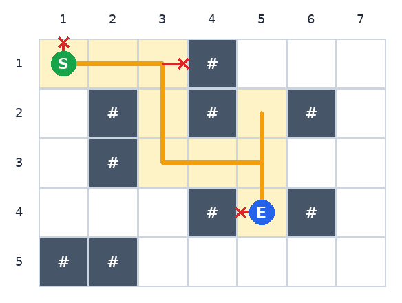

# Lab Robot

**Difficulty:** Easy &nbsp;|&nbsp; **Time limit:** HackerRank default &nbsp;|&nbsp; **Scoring:** Binary

## Problem Statement

During PUB CSE Fest-26, the robotics club lends the contest hall a small robot
named **Robu**, which carries water bottles to the teams.

The contest lab is a grid of **R** rows and **C** columns. Rows are numbered
1 to R from **top** to **bottom**, and columns 1 to C from **left** to
**right**. Each cell is one of:

- `.`: free floor
- `#`: a computer desk, which Robu cannot enter
- `S`: free floor where Robu starts (there is exactly one `S`)

Robu receives a string of **K** commands, one character each:
`U` (up one row), `D` (down one row), `L` (left one column), `R` (right one column).

Robu executes the commands **in order**. If a command would move it **outside the
lab** or **into a desk**, Robu ignores that command and stays where it is, then
continues with the next command.

After all commands are done, report:

1. Robu's final position (row and column), and
2. how many **different** cells Robu has stood on, **including the starting cell**.

## Input Format

- The first line contains two integers **R** and **C**.
- Each of the next **R** lines contains a string of **C** characters describing one
  row of the lab, from row 1 to row R.
- The next line contains an integer **K**.
- The last line contains a string of **K** characters, the commands.

## Constraints

- 1 ≤ R, C ≤ 100
- Each grid character is `.`, `#` or `S`, and there is exactly one `S`.
- 1 ≤ K ≤ 10<sup>5</sup>
- Each command is `U`, `D`, `L` or `R`.

## Output Format

Print two lines:

- The first line contains two integers: Robu's final row and column.
- The second line contains one integer: the number of different cells Robu has stood on.

## Sample Input 0

```
5 7
S..#...
.#.#.#.
.#.....
...#.#.
##.....
12
URRRDDRRUDDL
```

## Sample Output 0

```
4 5
9
```

## Explanation 0



Robu starts at (1, 1).

- `U` is ignored, because it would leave the lab.
- `R R` moves it to (1, 3). The next `R` is ignored, because (1, 4) is a desk.
- `D D` moves it to (3, 3), and `R R` to (3, 5).
- `U` moves it to (2, 5), and `D D` moves it back through (3, 5) to (4, 5).
- The final `L` is ignored, because (4, 4) is a desk.

Robu ends at row 4, column 5. The cells it stood on are (1,1), (1,2), (1,3),
(2,3), (3,3), (3,4), (3,5), (2,5) and (4,5). That is **9** different cells;
(3, 5) was visited twice but is counted once.

In the picture, the orange line is Robu's path, the shaded cells are the visited
cells, and a red ✕ marks an ignored command.
